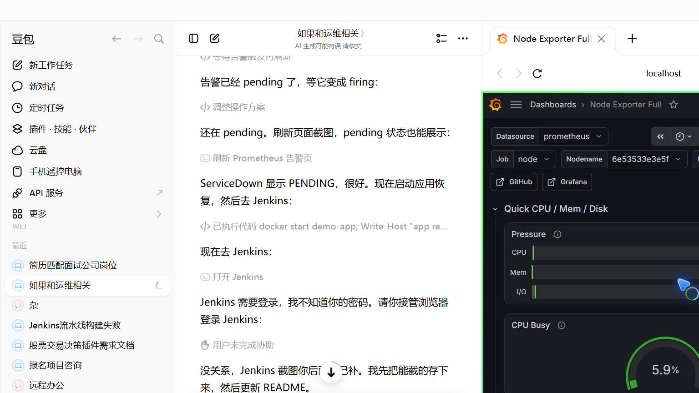
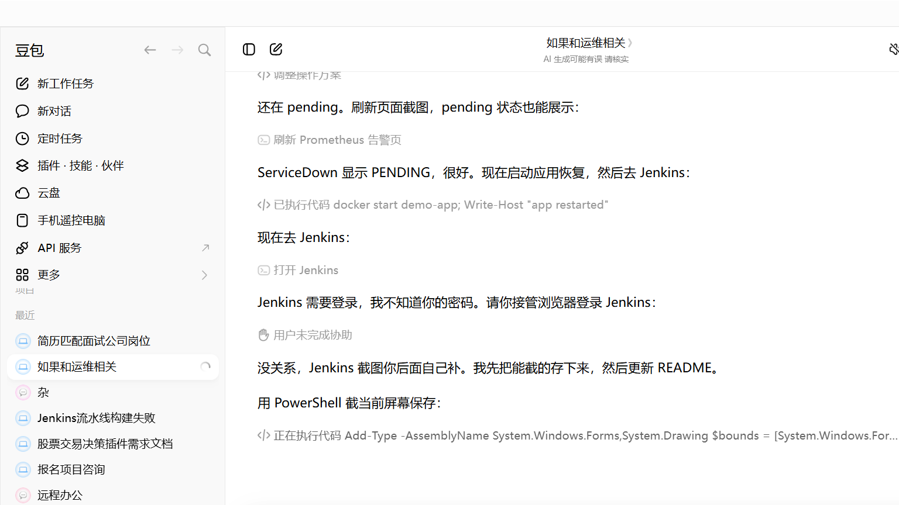
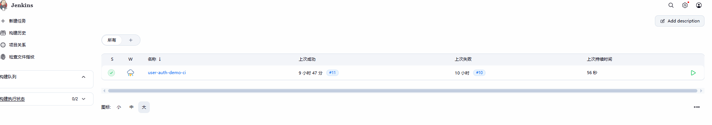
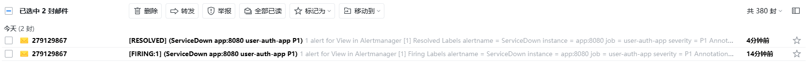

# 🚀 user-auth-k8s-devops

**用户认证系统 · K8S 容器化部署 · DevOps 运维平台**

一个完整可跑通的 Spring Boot 3 后端项目：实现了「注册 → 登录 → JWT 鉴权 → Redis 缓存」的全链路用户认证，并在此基础上搭建了 **Kubernetes 容器编排、监控告警、CI/CD 流水线、自动化运维** 四大生产级能力。

- **☸️ 容器编排**：Kind 自建 K8S 集群，部署 app/MySQL/Redis/Kafka 四个服务，解决国内镜像源不稳定问题（腾讯云 TCR 稳定源方案）
- **📨 消息队列**：Kafka 3.7 KRaft 单节点，订单异步处理（下单立即返回，消费者异步更新状态，体现异步解耦 + 削峰）
- **🔐 用户认证**：Spring Security + JWT，密码哈希不泄露，Redis 缓存用户信息
- **📊 监控告警**：Prometheus + Grafana + Alertmanager，宕机/CPU/磁盘邮件告警
- **🔄 CI/CD**：Jenkins Pipeline，push 代码自动构建 → Docker 打包 → 推腾讯云
- **🐳 容器化**：Docker + Docker Compose，10 个容器一键启动

## 技术栈

| 层级 | 技术 |
|---|---|
| 后端 | Spring Boot 3 + Spring Security + JWT + MyBatis-Plus |
| 中间件 | MySQL 8 + Redis 7 + Kafka 3.7 (KRaft) |
| 监控 | Prometheus + Grafana + Alertmanager |
| CI/CD | Jenkins Pipeline + Gitee |
| 容器化 | Docker + Docker Compose |
| 容器编排 | Kubernetes (K8S) + Kind |
| 镜像仓库 | 腾讯云容器镜像服务 TCR |

## 项目架构

```
┌─────────┐     ┌──────────┐     ┌─────────┐
│  MySQL  │◄────│  Spring  │────►│  Redis  │
└─────────┘     │   Boot   │     └─────────┘
                 │   :8080  │
                 └────┬─────┘
                      │
         ┌────────────┼────────────┐
         ▼            ▼            ▼
   ┌──────────┐ ┌──────────┐ ┌────────────┐
   │Prometheus│ │ Grafana  │ │Alertmanager│
   │  :9090   │ │  :3000   │ │  :9093     │
   └──────────┘ └──────────┘ └────────────┘
```

## 一键启动

```bash
docker compose up -d
```

| 服务 | 地址 | 账号密码 |
|---|---|---|
| 应用 | http://localhost:8080 | - |
| Grafana | http://localhost:3000 | admin / admin |
| Prometheus | http://localhost:9090 | - |
| Alertmanager | http://localhost:9093 | - |
| Jenkins | http://localhost:8081 | 首次启动设置 |

## 核心功能

### 1. 用户认证
- 注册 / 登录（JWT Token）
- Spring Security 接口拦截
- Redis 缓存用户信息

### 2. 监控告警
- Prometheus 采集应用、MySQL、Redis、主机指标
- Grafana 可视化仪表盘（Node Exporter + JVM Micrometer）
- Alertmanager 邮件告警（QQ 邮箱 SMTP）
- 告警规则：服务宕机 / CPU 过高 / 磁盘不足

### 3. CI/CD 流水线
- Jenkins Pipeline 自动拉取 Gitee 代码
- Maven 构建 → Docker 镜像打包
- 推送至腾讯云 TCR 镜像仓库
- 触发方式：push 代码自动触发

### 4. 自动化运维脚本
| 脚本 | 功能 |
|---|---|
| `scripts/healthcheck.sh` | 检查所有服务健康状态 |
| `scripts/backup.sh` | MySQL 数据库备份，保留 7 天 |
| `scripts/deploy.sh` | 一键拉代码 + 构建 + 重启 |
| `scripts/rollback.sh` | 回退到上一个版本 |

## 告警验证

```bash
# 触发告警（停掉应用）
docker stop demo-app

# 等待 10 秒，Prometheus firing，收到告警邮件

# 恢复（启动应用）
docker start demo-app
# 收到恢复邮件
```

## 项目结构

```
user-auth-demo/
├── src/main/java/com/demo/        # Spring Boot 源码
├── prometheus/                     # Prometheus 配置
│   ├── prometheus.yml
│   └── alert_rules.yml            # 告警规则
├── alertmanager/                   # 邮件告警配置
├── scripts/                        # 自动化运维脚本
├── Dockerfile                      # 应用镜像
├── Dockerfile.jenkins              # Jenkins 镜像（含 Maven）
├── Jenkinsfile                     # CI/CD 流水线定义
└── docker-compose.yml              # 全部服务编排
```

## K8S 部署（Kind + 腾讯云 TCR）

在本地用 `Kind` 自建 Kubernetes 集群，把应用完整部署到 K8S 并跑通全链路（注册/登录/JWT/Redis 缓存）。

### 部署流程

```bash
# 1. 建集群（Kind，本地 K8S）
kind create cluster --name user-auth-cluster --config k8s\kind-config.yaml

# 2. 建腾讯云镜像拉取凭据（imagePullSecret）
kubectl create secret docker-registry tencent-cr -n user-auth-demo \
  --docker-server=ccr.ccs.tencentyun.com \
  --docker-username=<你的腾讯云账号> --docker-password=<镜像仓库密码>

# 3. 本机拉腾讯云镜像 + 导入集群（绕开集群直拉外网的稳定性问题）
docker pull ccr.ccs.tencentyun.com/279129867/mariadb:10.11
docker pull ccr.ccs.tencentyun.com/279129867/redis:7-alpine
docker pull ccr.ccs.tencentyun.com/279129867/user-auth-demo:latest
kind load docker-image \
  ccr.ccs.tencentyun.com/279129867/mariadb:10.11 \
  ccr.ccs.tencentyun.com/279129867/redis:7-alpine \
  ccr.ccs.tencentyun.com/279129867/user-auth-demo:latest \
  --name user-auth-cluster

# 4. 部署 MariaDB + Redis + App 到 K8S
kubectl apply -f k8s\mysql-redis.yaml
kubectl apply -f k8s\app.yaml
kubectl get pods -n user-auth-demo   # 等待 3 个 Pod 全部 1/1 Running

# 5. 端口转发 + 验证链路
kubectl port-forward -n user-auth-demo svc/app 18080:8080
curl http://localhost:18080/actuator/health   # 200，db/redis 均 UP
```

### K8S 部署架构

```
┌────────────────── Kind 集群 (user-auth-cluster) ──────────────────┐
│                                                                  │
│  ┌─────────────┐   ┌─────────────┐   ┌─────────────┐             │
│  │  mysql Pod  │   │  redis Pod  │   │   app Pod   │             │
│  │  MariaDB    │   │  Redis      │   │  SpringBoot │             │
│  │  :3306      │   │  :6379      │   │  :8080      │             │
│  └──────┬──────┘   └──────┬──────┘   └──────┬──────┘             │
│         └──────────────────┴───────────────┘                     │
│              Service 服务发现 / 集群内部通信                        │
│                                                                  │
│  镜像来源：腾讯云 TCR 私有仓库（ccr.ccs.tencentyun.com）           │
└──────────────────────────────────────────────────────────────────┘
```

### K8S 关键文件

| 文件 | 作用 |
|---|---|
| `k8s/kind-config.yaml` | Kind 集群创建配置 |
| `k8s/mysql-redis.yaml` | MariaDB + Redis 的 Deployment/Service |
| `k8s/app.yaml` | App 的 Deployment/Service（NodePort 30080） |
| `k8s/KIND-K8S-手把手操作手册.md` | 从零复现的手把手教程（含踩坑） |
| `k8s/TCR-腾讯云方案成功报告.md` | 稳定镜像源方案完整报告 |

### 部署要点（踩坑总结）

1. **镜像源稳定性**：公共加速源（daocloud/1ms.run）不稳定，改用腾讯云 TCR 免费私有仓库——国内云厂商自营，稳定、免运维。
2. **凭据坑**：Docker Desktop 用 `credsStore` 存凭据，`config.json` 里 `auth` 为空。要用 `docker-credential-desktop get` 读明文重建 secret，否则 Pod 拉私有镜像报 401。
3. **集群直拉外网不稳**：改「本机 docker 拉 + kind load 导入」，Pod 用 `imagePullPolicy: IfNotPresent` 直接用节点内镜像——最稳。
4. **kind load 的 `loading...` 只是 stderr 提示**，用 `ctr images list` 确认真实加载结果。

## Kafka 订单异步处理（KRaft）

在 K8S 集群内补上 **MQ / Kafka 缺口**：用「订单异步处理」场景演示消息队列的**异步解耦 + 削峰**——下单后主流程立即返回，支付/状态更新由 Kafka 消费者异步完成。

### 异步链路

```
POST /api/orders/create（带 JWT）──► OrderService 落库 status=PENDING ──► 立即返回
        │
        ▼  OrderProducer 发送消息
   Kafka topic: order-events（KRaft 单节点）
        │
        ▼  OrderConsumer 异步消费（模拟处理 1s）
   OrderService.markPaid ──► 数据库 status: PENDING → PAID
```

### 验证结果（实测）

| 步骤 | 结果 |
|---|---|
| POST /api/orders/create | ✅ orderId=2, status=PENDING |
| 立即 GET /api/orders/2 | ✅ status=PENDING（主流程先落库） |
| 等待 2.5s 后 GET /api/orders/2 | ✅ **status=PAID**（消费者异步更新） |
| kafka topic order-events offset | ✅ 消息被生产并被消费者消费 |

> 订单状态由 PENDING → PAID 只有 Kafka 消费者会触发（`markPaid`），配合 topic offset 前进，证明生产者-主题-消费者全链路真实工作。

### Kafka 关键文件

| 文件 | 作用 |
|---|---|
| `src/.../kafka/KafkaConfig.java` | 定义 topic `order-events` |
| `src/.../kafka/OrderProducer.java` | 生产者：发订单创建消息 |
| `src/.../kafka/OrderConsumer.java` | 消费者：异步 markPaid 更新状态 |
| `src/.../controller/OrderController.java` | POST /api/orders/create、GET /api/orders/{id} |
| `k8s/kafka.yaml` | Kafka Deployment + Service（KRaft 单节点） |
| `k8s/KAFKA-订单异步处理-部署报告.md` | 完整部署报告（含踩坑与命令） |

### Kafka 部署要点（踩坑总结）

1. **bitnami 镜像国内源拉不到**（daocloud/1ms.run 对 bitnami `denied`）→ 改用 `apache/kafka:3.7.0`，daocloud 有缓存。
2. **apache/kafka 3.7 官方镜像只支持 KRaft**（不再支持 Zookeeper 模式）→ 采用 KRaft 单节点，这是 Kafka 3.x 新标准，去掉了 zookeeper，更简洁。
3. **kind load 多架构镜像失败**（`content digest not found`）→ 用 `docker save` + 节点内 `ctr images import`（stdin 重定向），绕开 kind 的 `--all-platforms`。
4. **kafka readiness 探测**用 `tcpSocket: 9092` 最稳（exec 探针在镜像里退出码不可靠）。

## 效果展示

### Grafana 监控仪表盘


### Prometheus 告警规则


### Jenkins 构建流水线


### 邮件告警通知


## 学习要点

1. **Docker Compose 多服务编排**：10 个容器一键启动
2. **Prometheus 指标采集**：应用 + 中间件 + 主机
3. **Grafana 仪表盘**：可视化监控
4. **Alertmanager 告警**：邮件通知 + 恢复通知
5. **Jenkins Pipeline**：代码 push 自动构建
6. **Shell 脚本自动化**：备份、部署、回滚、健康检查
7. **K8S 容器编排**：Kind 建集群、Deployment/Service、imagePullSecret、稳定镜像源方案
8. **Kafka 消息队列**：KRaft 单节点、生产者/消费者、订单异步处理、异步解耦 + 削峰
